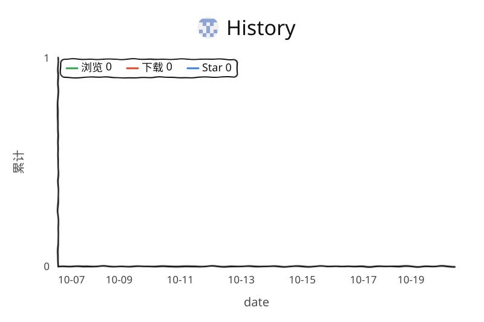

# PT Torrent Link Export

油猴脚本：在 PT 站列表页 / 做种页一键导出带凭据的种子直链，支持全部分页，可选附加免费令牌参数。

直接去 [Releases](https://github.com/ccrichard3/pt-torrent-link-export/releases) 下最新版即可。

自动识别三种主流引擎，不依赖域名硬编码：

| 引擎 | 下载地址形态 | 凭据 | 令牌参数 |
|---|---|---|---|
| **Gazelle** | `torrents.php?action=download&id=<id>&authkey=..&torrent_pass=..` | `authkey` + `torrent_pass` | `usetoken=1` |
| **NexusPHP** | `download.php?id=<id>&passkey=..` | `passkey` | `usetoken=1` |
| **UNIT3D / BHD** | `/torrent/download/auto.<id>.<rsskey>` | `rsskey` | 无（走 POST，URL 不支持） |

BHD 的 `rsskey` 是**大小写混合字母数字**，不是十六进制；列表页往往不渲染它，脚本会自动去 `/rss`、`/user/settings` 等位置补全一次。

## 安装

两种方式，任选其一：

**从 Releases 装**（推荐）：去 [Releases](https://github.com/ccrichard3/pt-torrent-link-export/releases) 下载最新的 `pt-torrent-link-export.user.js`，Tampermonkey 会自动弹出安装页。

**从源码装**：

1. 装 [Tampermonkey](https://www.tampermonkey.net/)
2. 打开 [`pt-torrent-link-export.user.js`](./pt-torrent-link-export.user.js) 的 raw 链接
3. Tampermonkey 会弹出安装页，确认即可

## 使用

打开任意支持的站的种子列表或做种列表，右下角出现控制条：

```
⠿  使用免费令牌(✓)   全部页( )   [导出种子直链]
```

- **使用免费令牌**：在链接后附加令牌参数（Gazelle / NexusPHP 是 `usetoken=1`）。勾选时消耗的是**当前登录账号**的 FL 令牌，每颗种子一个。UNIT3D 不支持，该选项自动禁用。
- **全部页**：勾选则抓取当前筛选条件下的所有分页；不勾只导当前页。
- 点「导出种子直链」后弹出面板，可复制或下载 `.txt`。面板标题栏可拖动，`✕` 关闭。

导出的链接形如：

```
https://dicmusic.com/torrents.php?action=download&id=199223&authkey=<32hex>&torrent_pass=<32hex>&usetoken=1
https://pterclub.net/download.php?id=900001&passkey=<32hex>&usetoken=1
https://beyond-hd.me/torrent/download/auto.7001.<rsskey>
```

直接 `curl -OJ` 或浏览器打开即得 `.torrent`，拖进客户端即可。

## 支持的站点

脚本按**页面内容**识别引擎，所以同引擎的新站通常无需改动即可工作。以下域名已写入 `@match`：

**Gazelle**
`dicmusic.com` `redacted.sh` `redacted.ch` `orpheus.network` `gazellegames.net` `jpopsuki.eu` `animebytes.tv` `passthepopcorn.me` `bibliotik.me`

**NexusPHP**
`pterclub.net` `hdsky.me` `hdsky.my` `ourbits.club` `hhanclub.net` `ubits.club` `u2.dmhy.org` `gamegamept.com` `piggo.me` `hddolby.com` `hdchina.org` `hdhome.org` `tjupt.org` `byr.pt` `open.cd` `hdarea.co` `hdfans.org` `ptsbao.club` `haidan.cc` `discfan.net` `joyhd.net` `hdtime.org` `1ptba.com` `skyeysnow.com` `ptchina.org` `hdatmos.club` `xingtan.org` `moecat.best` `azusa.wiki` `sharkpt.net` `pthome.net` `keepfrds.com` `tccf.club`

**UNIT3D**
`beyond-hd.me` `blutopia.cc` `aither.cc` `lst.gg` `seedpool.org`

### 加新站

如果是上面任一引擎的站，只需在文件头加一行 `@match`：

```js
// @match        *://*.newtracker.com/*
// @match        *://newtracker.com/*
```

引擎识别靠页面里的凭据形态（`authkey=` / `passkey=` / `rsskey`），不用改逻辑。

若该站的令牌参数名不同（不是 `usetoken`），在 `SITE_OVERRIDES` 里覆盖：

```js
const SITE_OVERRIDES = {
  'newtracker.com': { tokenParam: 'freeleech' },
};
```

若分页参数名不同，同理可覆盖 `perPageParam` / `perPageValue`。

## 安全模型

**脚本文件本身不含任何凭据。** 凭据在运行时从当前页面 HTML 正则提取：

```js
authkey:      /authkey=([a-f0-9]{16,64})/i
torrent_pass: /torrent_pass=([a-f0-9]{16,64})/i
passkey:      /passkey=([a-f0-9]{16,64})/i
rsskey:       /(?:rsskey[=:\/]|rss\/)([a-f0-9]{16,64})/i
```

缓存写在 Tampermonkey 本地存储，按「域名 + 引擎 + 账号 uid」隔离：

```
ptle::<hostname>::<engine>::<uid>::authkey
```

换号登录时 uid 不同，不会串用。清除缓存：Tampermonkey 该脚本的「存储」页。

## 重要提醒

导出的链接里带着**你的**凭据，等于把账号交出去：

- 别人用这个链接下载、做种，**流量全部记在你的账号上**，对方账号零记录
- 勾了「使用免费令牌」，消耗的是**你的** FL 令牌，不是点链接的人的
- 种子内 announce 用凭据认人，多 IP 同时活动可能被判定账号共享

分享前想清楚，别把整份做种列表的直链公开贴出去。

## 开发

```sh
npm install
node test/run-tests.mjs
```

测试用 jsdom 模拟三类站点的列表页，覆盖引擎识别、凭据提取、分页抓取、勾选框兜底、空页面诊断，以及「脚本内无硬编码密钥」的静态检查。全部用假凭据，不联网。

## 许可

MIT

## 使用趋势

<picture>
  <source media="(prefers-color-scheme: dark)" srcset="traffic/views-dark.svg" />
  <source media="(prefers-color-scheme: light)" srcset="traffic/views.svg" />
  
</picture>

## 关于「链接里有没有凭据」

不同站的下载链接差别很大，这直接决定导出的链接**能不能分享给别人**：

| 站 | 链接形态 | 凭据 | 能分享吗 |
|---|---|---|---|
| Gazelle（DIC/HappyFappy 等） | `?action=download&id=..&authkey=..&torrent_pass=..` | URL 内 | ✅ 可离线下载 |
| NexusPHP（PterClub 等） | `download.php?id=..&passkey=..` | URL 内 | ✅ 可离线下载 |
| UNIT3D / BHD / ClearJav / BitPorn | `/torrents/download/<id>`、`/download/<slug>.<id>` | **仅会话 cookie** | ❌ 只对你自己的浏览器有效 |

后一类的链接打开时靠 `beyondhd_session` 之类的 cookie 鉴权，**没有可嵌入的密钥**。所以：

- 这些链接复制到别的浏览器 / 别的机器 → 会跳到登录页
- 想分享只能拿到 `rsskey`（BHD 在 `/rss` 页面，部分 UNIT3D 站在个人设置里），拼成
  `/torrent/download/auto.<id>.<rsskey>` 形式
- 脚本会自动尝试去 `/rss` 探测一次；取不到就如实提示「缺少 rsskey」，不会编造假链接

ClearJav / BitPorn 这类站即使登录了也不暴露 rsskey，属于**无法生成可分享直链**的站点，只能导出自用。
